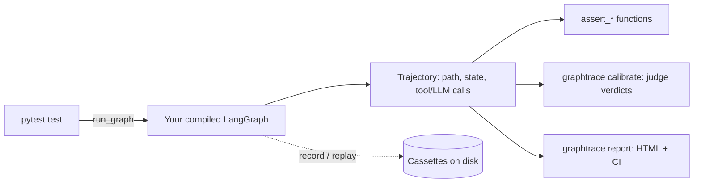

# graphtrace

**Regression testing for LangGraph agents, built as a pytest plugin.**

!!! note "Status: v0.1 complete, heading toward release"
    Everything described on this page is real and tested today — 181 tests pass, full regression. See [Roadmap & status](project/roadmap.md) for the exact build history, including every real bug found and fixed along the way.

## The problem

Most LangGraph agents are tested the way nothing else in a codebase is: by rereading the final message, or not at all. A graph with branches, retries, and tool calls can look fine on a lucky run while silently changing *how* it got there — a different node path, a retry that's now happening every time, a tool call that quietly stopped firing, a human-approval gate the agent learned to route around. A test that only checks the final answer text can't catch any of that, because the final answer can still look right while the path that produced it is wrong, expensive, or unsafe.

## What graphtrace does

graphtrace records a full **trajectory** of a graph run — every node visited, every state change, every tool and LLM call, in order — and lets a test assert on what the agent *did*, not just what it said:

```python
assert_path(traj, ["router", ..., "refund"])
assert_tool_called(traj, "refund_api", args_match={"order_id": "1234"})
assert_budget(traj, cost_usd=0.05, latency_s=8)
```



In `replay` mode (the intended default for CI), the LLM and tool boxes are never reached — responses come from cassettes, so a test suite runs offline and deterministically. A production trace export (Langfuse/OTel/LangSmith) can also become a cassette + generated test directly, via `graphtrace from-trace`, without a real LangGraph run at all.

## Who this is for

- **Teams shipping a LangGraph agent to production** who want the same regression-testing discipline they'd expect for any other code path, not spot-checks by hand.
- **Anyone refactoring a graph's branching or retry logic** who wants a test that fails the moment the *path* changes, even when the final answer still happens to look right.
- **Consultants and auditors** who need a framework-agnostic way to pin down exactly what an agent does before recommending a fix.

## Design principles that shape every feature

- **Framework-agnostic core.** Everything downstream of recording — assertions, budgets, the HTML report — works on a plain `Trajectory` object with no LangGraph import anywhere near it. LangGraph-specific code lives in exactly one layer (`frameworks/langgraph/`); CrewAI/AutoGen (v0.4) plug into the same core without touching the rest.
- **Offline by default, once cassettes exist.** A CI run shouldn't have to call a real model or a real tool to pass.
- **No invented numbers.** Cost, token, and judge-agreement figures come from real recorded usage or a real live call, never an estimate.

## Next steps

- New to graphtrace? Start with [Installation](getting-started/installation.md) and the [Quickstart](getting-started/quickstart.md).
- Want to see exactly what's built, including every real bug found along the way? Check [Roadmap & status](project/roadmap.md).
- Pointing this at a judge-graded or production-trace workflow? See [Judge & calibration](guide/judge-and-calibration.md) and [Trace-to-test](guide/trace-to-test.md).
