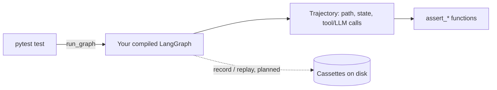

# graphtrace

**Regression testing for LangGraph agents, built as a pytest plugin.**

!!! note "Status: early development"
    graphtrace is being built in the open, feature by feature. This guide grows alongside the code — every page below is either real, verified documentation for something that works today, or a clearly marked placeholder for something planned. See [Roadmap & status](project/roadmap.md) for exactly what's implemented right now.

## The problem

Most LangGraph agents are tested the way nothing else in a codebase is: by rereading the final message, or not at all. A graph with branches, retries, and tool calls can look fine on a lucky run while silently changing *how* it got there — a different node path, a retry that's now happening every time, a tool call that quietly stopped firing. A test that only checks the final answer text can't catch any of that, because the final answer can still look right.

## What graphtrace does

graphtrace records a full **trajectory** of a graph run — every node visited, every state change, every tool and LLM call, in order — and lets a test assert on what the agent *did*, not just what it said:

```python
assert_path(traj, ["router", ..., "refund"])
assert_tool_called(traj, "refund_api", args_match={"order_id": "1234"})
assert_budget(traj, cost_usd=0.05, latency_s=8)
```



Once recording and replay are built (see the roadmap), the LLM and tool boxes are never reached in CI — responses come from cassettes, so a test suite runs offline and deterministically.

## Who this is for

- **Teams shipping a LangGraph agent to production** who want the same regression-testing discipline they'd expect for any other code path, not spot-checks by hand.
- **Anyone refactoring a graph's branching or retry logic** who wants a test that fails the moment the *path* changes, even when the final answer still happens to look right.
- **Consultants and auditors** who need a framework-agnostic way to pin down exactly what an agent does before recommending a fix.

## Design principles that shape every feature

- **Framework-agnostic core.** Everything downstream of recording — assertions, budgets, the eventual HTML report — works on a plain `Trajectory` object with no LangGraph import anywhere near it. LangGraph-specific code lives in exactly one layer; another agent framework could plug into the same core later without touching the rest.
- **Offline by default, once cassettes exist.** A CI run shouldn't have to call a real model or a real tool to pass.
- **No invented numbers.** Cost and token budgets are checked against real recorded usage, never an estimate.

## Next steps

- New to graphtrace? Start with [Installation](getting-started/installation.md).
- Want to see what's actually built today, not just planned? Check [Roadmap & status](project/roadmap.md).
- Curious how the assertion API works right now? See [Assertions](guide/assertions.md) — the one guide page that's fully real and tested today.
